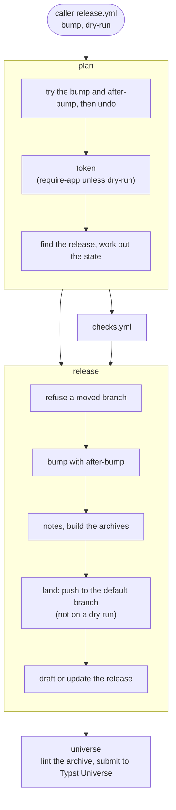

# Typst Workflows

Reusable GitHub Actions workflows and actions for Typst packages.

This repository holds the CI that [gribouille](https://github.com/mcanouil/gribouille) and [keisen](https://github.com/mcanouil/keisen) share.
Each package keeps its own checks in its own scripts.
The workflows here only set up the tools and call those scripts, so a run on your machine and a run in CI do the same thing.

## Repository contract

A package that calls these workflows provides the files below.

| File | What the workflows expect |
| --- | --- |
| `typst.toml` | A `compiler` key, which sets the Typst version that CI installs. The release reads `name`, `repository` and `homepage`, and bumps `version`, which is the source of the current version. |
| `tools/check.sh` | The full local suite. It exits 0 when every check passes and 1 otherwise. It accepts extra arguments. |
| `tools/dry-release.sh` | Stages the package, installs it as `@preview/<name>:<version>`, compiles against that copy, and lints the payload with `typst-package-check`. It honours `XDG_DATA_HOME` and `STAGE_ROOT`. |
| `tools/package.sh` | `archive <out>` writes `<name>-<version>.tar.gz` and `<name>-<version>.zip`, each with a single `<name>-<version>/` root. |
| `CHANGELOG.md` | A `## Unreleased` heading, which the bump turns into `## X.Y.Z (YYYY-MM-DD)`. The release notes are the lines under that heading. |
| `.github/universe.md` | The paragraph that describes the package in the Typst Universe pull request. A package that isn't on Typst Universe yet also needs a line that starts with `Name:` and explains the name. |
| `.editorconfig` | The indentation that shfmt reads. Keep it out of the published package with the `exclude` list in `typst.toml`. |
| `docs/_quarto.yml` | A `website.site-url`, which sets the URLs in `versions.json`. Write the URL itself there; an alias such as `*site-url` belongs on the other keys that repeat it. |
| Quarto profiles | `release`, `dev` and `no-release` under `docs/`. The `dev` profile renders into `_site/dev` and points `site-url` at `/dev`. |

## Checks

`.github/workflows/checks.yml` runs three jobs:

- `suite` runs `tools/check.sh`.
- `package` installs `typst-package-check` and runs `tools/dry-release.sh`.
- `lint` runs shellcheck and shfmt over the package's shell scripts.

Every job skips a draft pull request.
Add `ready_for_review` to your `pull_request` types, so the checks run once the draft is lifted.

| Input | Type | Default | Use |
| --- | --- | --- | --- |
| `needs-lua` | boolean | `false` | Installs Lua 5.4 for the suite and the package job. |
| `needs-quarto` | boolean | `false` | Installs the current Quarto release for the suite. |
| `needs-imagemagick` | boolean | `false` | Installs ImageMagick for the suite, if the runner lacks it. |
| `check-args` | string | `""` | Extra arguments for `tools/check.sh`. |
| `failure-artifacts` | string | `""` | Paths, one per line, that the suite uploads when it fails. |
| `shellcheck-paths` | string | `tools/*.sh .github/scripts/*.sh docs/_scripts/*.sh` | Globs that shellcheck reads. |
| `shfmt-paths` | string | `tools/*.sh .github/scripts/*.sh` | Globs that shfmt reads. |

Each list of globs must match at least one file, or the lint job fails.
A glob that matches nothing usually means that a path moved.

Here's a minimal caller:

```yaml
name: Checks

on:
  pull_request:
    types: [opened, synchronize, reopened, ready_for_review]
  push:
    branches:
      - main

permissions:
  contents: read

concurrency:
  group: ${{ github.workflow }}-${{ github.event_name == 'pull_request' && github.ref || github.sha }}
  cancel-in-progress: ${{ github.event_name == 'pull_request' }}

jobs:
  checks:
    uses: mcanouil/typst-workflows/.github/workflows/checks.yml@v2
    with:
      needs-lua: true
```

The concurrency group cancels a superseded run on a pull request.
On `main`, every commit gets a group of its own, so each one keeps its result.

## Documentation

`.github/workflows/docs.yml` publishes the site under `docs/` to GitHub Pages.
The latest version tag renders at the site root, and the calling ref renders at `/dev/`.
Before the first tag, the calling ref renders alone at the root with the `no-release` profile.
Each site checks out its own ref, so it compiles with the Typst version that its own `typst.toml` pins.

A pull request builds every site and deploys nothing, so a broken page shows up before it lands.
The deploy writes `versions.json` at the site root, which a version switcher can read on every site.

| Input | Type | Default | Use |
| --- | --- | --- | --- |
| `ref` | string | `""` | The commit or ref to resolve the tag from and to render as `dev`. Empty means the calling ref. |
| `needs-lua` | boolean | `false` | Installs Lua 5.4 for pre-render scripts and the development archive. |
| `figure-cache` | string | `""` | The typst-render cache to restore and save, such as `docs/.quarto/typst-render`. |
| `dev-archive` | boolean | `false` | Writes a dated `tools/package.sh archive` into the development site. |

Here's a minimal caller:

```yaml
name: Docs

on:
  pull_request:
    types: [opened, synchronize, reopened, ready_for_review]
  push:
    branches:
      - main
  workflow_call:
    inputs:
      ref:
        type: string
        default: ""

permissions:
  contents: read

concurrency:
  group: ${{ github.event_name == 'pull_request' && format('docs-pr-{0}', github.ref) || 'pages' }}
  cancel-in-progress: ${{ github.event_name == 'pull_request' || github.event_name == 'push' }}

jobs:
  docs:
    uses: mcanouil/typst-workflows/.github/workflows/docs.yml@v2
    permissions:
      contents: read
      pages: write
      id-token: write
    with:
      ref: ${{ inputs.ref }}
```

GitHub Pages takes one deployment at a time, so every deploy shares the `pages` group.
A push cancels the older run, because the newer one renders the same site from fresher sources.
The `workflow_call` trigger lets the Publish workflow deploy the docs once it has tagged a release.

## Release

`.github/workflows/release.yml` prepares a release and submits it to Typst Universe.
It runs four jobs:

- `plan` works out the version and tries the bump, so an empty `## Unreleased` fails in seconds. It also refuses a version that already has a release.
- `checks` runs `checks.yml` on the dispatched commit.
- `release` bumps the version with [release-actions](https://github.com/mcanouil/release-actions) `bump`, in `typst.toml` and in each file of `targets`, runs `after-bump`, and builds the archives at that commit. Only then does it push the commit `ci: release X [skip ci]` straight to the default branch with the GitHub App, through the release-actions `land` action, and keep the archives in a draft GitHub Release, with the changelog section as its notes.
- `universe` runs on the `typst-universe` environment, so it waits for your approval. It compiles the package of the draft and its template entrypoint, which fills the Typst package cache, then lints the archive, syncs the fork of `typst/packages`, pushes the package on the branch `<name>-<version>`, and opens the pull request `<name>:<version>`, or reuses the open one. The body lists the changelog section as the changes.



With `bump: none`, the run resubmits the current draft after review feedback on `typst/packages`.
It rebuilds the archives from the default branch, moves the draft to that commit, and force-pushes the same branch, which updates the open pull request.
If a run pushed the version and then stopped before the draft, `bump: none` creates the draft.
It refuses a version that Typst Universe already serves, since that would change bytes it has accepted.

With `dry-run: true`, nothing is pushed to your repository, no draft is created and no pull request is opened.
The fork is still synced, and `git push --dry-run` checks that the App can write to it.
A dry run can start from any branch, while a real release refuses anything but the default branch.

| Input | Type | Default | Use |
| --- | --- | --- | --- |
| `bump` | string | | `patch`, `minor`, `major`, or `none` to resubmit the draft. |
| `dry-run` | boolean | `false` | Rehearses the whole run with no push, no draft and no pull request. |
| `targets` | string | `""` | YAML list of [release-actions `bump` targets](https://github.com/mcanouil/release-actions#bump) for the files other than `typst.toml`, which the workflow adds itself. Each item starts at column 0. |
| `after-bump` | string | `""` | A command run after the bump and before the commit, such as `tools/version-check.sh`. The plan job also runs it on its trial bump, so a broken command fails before the checks. A failure stops the run before anything is pushed. The bump commit includes the files it changes or creates, except files that `.gitignore` matches. |
| `needs-lua`, `needs-quarto`, `needs-imagemagick`, `check-args`, `failure-artifacts`, `shellcheck-paths`, `shfmt-paths` | | as in `checks.yml` | Passed on to the checks. |
| `universe-fork` | string | `typst-universe-packages` | The fork of `typst/packages`, under the same owner. |

Here's a minimal caller:

```yaml
name: Release

on:
  workflow_dispatch:
    inputs:
      bump:
        type: choice
        default: "minor"
        options: ["patch", "minor", "major", "none"]
      dry-run:
        type: boolean
        default: false

permissions:
  contents: read

concurrency:
  group: release
  cancel-in-progress: false

jobs:
  release:
    uses: mcanouil/typst-workflows/.github/workflows/release.yml@v2
    secrets: inherit
    with:
      bump: ${{ inputs.bump }}
      dry-run: ${{ inputs.dry-run }}
      after-bump: tools/version-check.sh
      targets: |
        - file: CITATION.cff
          pattern: '^version: {version}$'
        - file: CITATION.cff
          pattern: '^date-released: "{date}"$'
        - file: README.md
          pattern: '@preview/gribouille:{version}'
```

Each target must match at least once, or the bump fails before it writes anything.
A `CITATION.cff` with no `date-released` line yet needs that line before the first release, or `required: false` on its target.

## Publish

`.github/workflows/publish.yml` finishes the release once Typst Universe has accepted it.
It finds the draft for the version in `typst.toml`, and asks `packages.typst.org` whether it serves that version.
If it does, Publish publishes the draft, and GitHub creates the tag at the commit of the draft.
If it doesn't yet, the run stops and changes nothing.
If the release is already published, the run moves straight on to the docs.

The caller deploys the docs in a second job, with its own `docs.yml`, so its docs inputs stay in one place:

```yaml
name: Publish

on:
  workflow_dispatch:

permissions:
  contents: read

concurrency:
  group: release
  cancel-in-progress: false

jobs:
  publish:
    uses: mcanouil/typst-workflows/.github/workflows/publish.yml@v2
    secrets: inherit

  docs:
    needs: publish
    permissions:
      contents: read
      pages: write
      id-token: write
    uses: ./.github/workflows/docs.yml
```

The new tag renders at the site root, and the default branch renders at `/dev/`.

## Snapshot refresh

`.github/workflows/snapshot-refresh.yml` regenerates the visual goldens and lands them.
It installs Typst from `typst.toml`, Lua 5.4 and ImageMagick, then runs `command`.
`land` then opens or updates a pull request on `ci/snapshot-refresh`, or pushes to the dispatched branch when `direct` is true.
A run that changes no golden ends green.
The job needs the App, because a direct push must bypass the branch rules.

| Input | Type | Default | Description |
| --- | --- | --- | --- |
| `direct` | boolean | `false` | Pushes the goldens to the dispatched branch instead of opening a pull request. |
| `force` | boolean | `false` | Deletes every golden first, so all snapshots re-mint and orphaned files go. |
| `merge-method` | string | `squash` | Merge method of the pull request: `squash` or `merge`. |
| `goldens` | string | `tests/visual/golden` | Directory of the goldens. |
| `command` | string | `lua tools/snapshot/run.lua --update` | Command that regenerates the goldens. |

```yaml
name: Refresh visual snapshots

on:
  workflow_dispatch:
    inputs:
      direct:
        type: boolean
        default: false
      force:
        type: boolean
        default: false

permissions:
  contents: read

jobs:
  refresh:
    uses: mcanouil/typst-workflows/.github/workflows/snapshot-refresh.yml@v2
    secrets: inherit
    permissions:
      contents: write
      pull-requests: write
    with:
      direct: ${{ inputs.direct }}
      force: ${{ inputs.force }}
```

## Dependency update

`.github/workflows/dependency-update.yml` follows the latest GitHub release of Typst and of each package in `packages`.
When a version moves, it writes the `compiler` key of `typst.toml` and the `@preview/<name>:<version>` imports of the named file.
Then `land` opens or updates one pull request on `ci/bump-typst-deps`, which it does not merge.
A run that finds nothing to move ends green.
The caller sets the schedule.

| Input | Type | Default | Description |
| --- | --- | --- | --- |
| `packages` | string | `""` | YAML list of `name`, `repository` and `file`. Empty follows the compiler alone. |

```yaml
name: Dependency update

on:
  schedule:
    - cron: "0 9 * * 1"
  workflow_dispatch:

permissions:
  contents: read

jobs:
  bump:
    uses: mcanouil/typst-workflows/.github/workflows/dependency-update.yml@v2
    secrets: inherit
    permissions:
      contents: write
      pull-requests: write
    with:
      packages: |
        - name: cetz
          repository: cetz-package/cetz
          file: src/deps.typ
```

## Release runbook

Before the first release, set up these once in each package repository:

- Install the GitHub App on the package repository and on the fork of `typst/packages`, with `Contents` and `Workflows` write access. The fork sync fails without `Workflows` when an upstream commit touches `.github/workflows`.
- Add the App to the bypass list of the ruleset that protects the default branch, so it can push the bump.
- Store the App id as the `APP_ID` variable and its private key as the `APP_KEY` secret.
- Create the `typst-universe` environment, with yourself as required reviewer.
- Create a classic personal access token with the `public_repo` scope alone, and store it as `UNIVERSE_TOKEN` on that environment. GitHub lets only a classic token open a pull request on a public repository that you don't own, and the workflow refuses a token with any other scope.

Then, for each release:

1. Run Release with `patch`, `minor` or `major`, and approve the `typst-universe` environment when it asks.
2. Wait for the pull request on `typst/packages` to merge.
3. Run Publish.

If the reviewers on `typst/packages` ask for a change, fix it on the default branch and run Release with `none`.

If CI can't submit, you can submit from a clone of this repository with your own `gh` login:

```sh
gh release download <version> --repo <owner>/<package> --pattern '<package>-<version>.tar.gz'
actions/universe-submit/submit.sh --name <package> --version <version> \
  --archive <package>-<version>.tar.gz --description <clone>/.github/universe.md \
  --fork <owner>/typst-universe-packages --sync
```

Add `--dry-run` to rehearse it, or `--pr=<number>` to reuse the branch of an open pull request.

## Actions

The workflows are built from these composite actions, which you can also use on their own:

- `actions/setup-typst` reads `compiler` from `typst.toml` and installs that Typst.
- `actions/run-logged` runs a command and writes its status, and the end of its output on failure, to the step summary.
- `actions/lint-shell` installs shfmt and runs shellcheck and shfmt.
- `actions/setup-package-check` installs `typst-package-check`, cached by the upstream revision.
- `actions/docs-matrix` builds the docs render matrix and the `versions.json` list from the latest tag and `site-url`.
- `actions/find-release` finds the release of a version, draft or published, and the id of one of its assets.
- `actions/fill-package-cache` compiles a package and its template entrypoint, so that `typst-package-check` finds their dependencies in the Typst cache.
- `actions/universe-served` asks `packages.typst.org` whether it serves a package version.
- `actions/universe-submit` checks the pull request token, then syncs the fork, pushes the package and opens or reuses the pull request on `typst/packages`.
- `actions/bump-pins` moves the `compiler` key of `typst.toml` and the listed `@preview` imports to their latest GitHub releases.

## Versioning

Call everything with `@v2`.
Each release publishes three tags: `vX.Y.Z`, which never moves, and `vX.Y` and `vX`, which roll forward on to each new release they cover.
Pin `v2` to get every compatible release, or a fixed `v2.x.y` if you'd rather choose when to move.
A change that breaks callers starts `v3`.

Releases are cut by the Version workflow, which you run by hand from `main` with `patch`, `minor` or `major`.
It uses [release-actions](https://github.com/mcanouil/release-actions): it works out the next version from the latest tag, rolls `## Unreleased` in `CHANGELOG.md`, updates `CITATION.cff`, and pushes the commit `ci: release vX.Y.Z [skip ci]` as the GitHub App.
It then tags that commit, moves the rolling tags, and publishes a GitHub Release whose body is the changelog section and the generated notes.
It refuses an empty `## Unreleased`, and it refuses a major release until the usage examples in this README pin the new major, so that change lands as a pull request first.
The tags are lightweight on purpose, because GitHub doesn't resolve an annotated tag for a relative workflow reference.

## Development

Run the checks before you push:

```sh
actionlint
actions/lint-shell/lint-shell.sh "actions/*/*.sh tests/*.sh" "actions/*/*.sh tests/*.sh"
tests/run.sh
```

The tests need Bash 4.4 or newer, shellcheck and shfmt.

## Licence

MIT, see [LICENSE](LICENSE).
